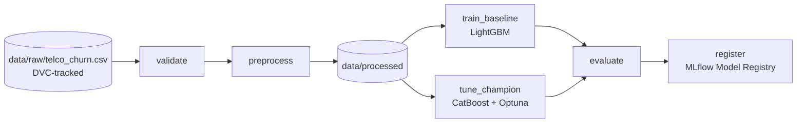

# ChurnOps

A containerised MLOps pipeline for telecom customer churn prediction on AWS.
The focus is pipeline reliability and reproducibility rather than peak accuracy.

**Team:** 22l-6841, 22l-6761, 22i-0896

## Phase 1: Data versioning, training pipeline, experiment tracking, model registry

| Requirement | Implementation |
|---|---|
| Dataset & versioning | Raw CSV tracked with `dvc add`; processed splits and model files are DVC pipeline outputs; all pushed to an S3 remote |
| Pipeline implementation | Six-stage DVC pipeline (`dvc.yaml`): validate → preprocess → train_baseline → tune_champion → evaluate → register |
| Experiment tracking | MLflow logs parameters, metrics, artifacts and tags for every run, including one nested run per Optuna trial |
| Model registry | Both models registered in MLflow under `churnops-churn-classifier`, with version tags and `@champion` / `@challenger` aliases |

This project is a standard (tabular) ML system, so the RAG and agentic-workflow pipeline options do not apply.
For tabular data, the "tokenization" step corresponds to categorical encoding: each categorical column gets a fixed category set fitted on the training split.

## Models

- **Baseline:** LightGBM with near-default settings and balanced class weights.
- **Champion:** CatBoost with native categorical handling, tuned with Optuna (TPE sampler, 30 trials, objective = validation PR-AUC).
- **Decision threshold:** chosen on validation data to maximise churn-class F1 while keeping recall ≥ 0.70.
- **Selection rule:** best validation F1 among models meeting the recall floor. The test set is used only for the final report.

## Pipeline



| Stage | Script | Outputs |
|---|---|---|
| validate | `src/data/validate.py` | `reports/validation.json` (schema, categories, ranges, missing values, duplicates) |
| preprocess | `src/data/preprocess.py` | `data/processed/{train,val,test}.parquet`, `feature_spec.json` |
| train_baseline | `src/models/train_baseline.py` | `models/baseline/`, `metrics/baseline.json` |
| tune_champion | `src/models/tune_champion.py` | `models/champion/` (incl. `optuna_trials.csv`), `metrics/champion.json` |
| evaluate | `src/models/evaluate.py` | `metrics/test.json`, `reports/model_comparison.md` |
| register | `src/models/register.py` | `reports/registry.json` |

All settings (split sizes, seeds, search space, recall floor) live in `params.yaml`. DVC reruns only the stages whose code, data or parameters changed.

## Repository layout

```
├── dvc.yaml              # pipeline definition
├── params.yaml           # all configuration
├── requirements.txt
├── scripts/bootstrap.sh  # one-time DVC + S3 remote setup
├── src/
│   ├── common.py         # config, MLflow setup, run tags, hashing
│   ├── features.py       # shared train/serve feature preparation
│   ├── metrics.py        # metrics + threshold selection
│   ├── data/             # schema, ingest, validate, preprocess
│   └── models/           # train_baseline, tune_champion, evaluate, register
└── tests/                # pytest unit tests
```

## Setup

Requires Python 3.10+ and, for the S3 remote, AWS credentials (`aws configure`).

```bash
python -m venv .venv
source .venv/bin/activate          # Windows: .venv\Scripts\activate
pip install -r requirements.txt
```

### First-time data + DVC setup

```bash
aws s3 mb s3://<your-bucket>                  # once, if the bucket doesn't exist
bash scripts/bootstrap.sh <your-bucket>       # git init, dvc init, download data, dvc add, set S3 remote
```

Or the same steps manually:

```bash
git init && dvc init
python -m src.data.ingest
dvc add data/raw/telco_churn.csv
dvc remote add -d s3remote s3://<your-bucket>/dvcstore
```

### Run the pipeline

```bash
dvc repro            # runs all six stages
dvc push             # uploads raw data, processed splits and models to S3
dvc metrics show     # validation/test metrics
git add . && git commit -m "Run pipeline" && git push
```

On a fresh clone, `dvc pull` restores the exact data and models for the committed `dvc.lock`.

### Inspect experiments and the registry

```bash
mlflow ui --backend-store-uri sqlite:///mlflow.db
```

Open http://127.0.0.1:5000. The `churnops` experiment shows the baseline run and the CatBoost parent run with its 30 nested trials. **Models** shows `churnops-churn-classifier` with tagged versions and aliases.

Each registered version is tagged with: framework, decision threshold, DVC data hash (`data_version`), git commit, and validation/test F1, recall and ROC-AUC.

To load the current champion:

```python
import mlflow
model = mlflow.catboost.load_model("models:/churnops-churn-classifier@champion")
```

Set `MLFLOW_TRACKING_URI` to point at a remote tracking server instead of the local SQLite store (planned for Phase 4 on EC2 with S3 artifacts).

### Tests

```bash
pytest -q
```

## Phase 1 results

Telco Customer Churn (IBM), 7,043 customers, 26.5% churn; 70/15/15 stratified split.

| Model | Split | F1 | Recall | Precision | ROC-AUC | PR-AUC |
|---|---|---|---|---|---|---|
| LightGBM baseline | test | 0.602 | 0.746 | 0.505 | 0.834 | 0.643 |
| **CatBoost + Optuna (champion)** | test | **0.642** | **0.757** | **0.558** | **0.847** | **0.659** |

## Roadmap

1. ✅ Data cleaning, validation, baseline and champion models
2. ✅ MLflow experiment tracking, model registry, DVC data versioning
3. FastAPI service and Docker images
4. AWS deployment (ECR, EC2) and GitHub Actions CI/CD
5. Drift monitoring, retraining trigger and final report
